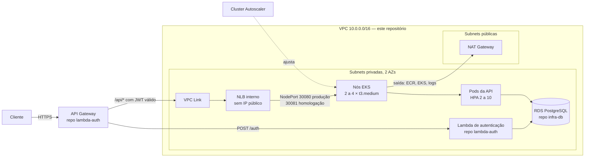

# autopecas-infra-k8s

Infraestrutura Kubernetes do sistema de oficina mecânica (Tech Challenge FIAP
16SOAT, Fase 3): rede, cluster **Amazon EKS** com escalabilidade em dois níveis
e a ponte privada (**NLB interno + VPC Link**) por onde o API Gateway alcança a
aplicação — sem que o cluster tenha nenhuma entrada pública.

Provisionado inteiramente por **Terraform**, com deploy automático por GitHub
Actions. Feito para rodar no **AWS Academy Learner Lab**, e funciona também numa
conta AWS comum.

## Os quatro repositórios do projeto

| Repositório | Responsabilidade |
|---|---|
| [`autopecas-lambda-auth`](https://github.com/16soat-fiap/autopecas-lambda-auth) | Lambda de autenticação por CPF/CNPJ (emite o JWT) e o API Gateway |
| **`autopecas-infra-k8s`** (este) | Rede, cluster EKS, autoscaling, NLB interno, VPC Link, ECR |
| [`autopecas-infra-db-teste`](https://github.com/16soat-fiap/autopecas-infra-db-teste) | RDS PostgreSQL gerenciado e usuários restritos |
| [`16SOAT-TechChallenge1`](https://github.com/16soat-fiap/16SOAT-TechChallenge1) | Aplicação Spring Boot e seus manifestos Kubernetes |

Swagger e endpoints da API: ver o repositório da aplicação. Em execução, o
Swagger fica em `<URL do API Gateway>/swagger-ui.html`.

## Arquitetura



**A cadeia de confiança é por security group**, nunca por faixa de IP: o VPC
Link só sai para o NLB, o NLB só entrega no NodePort dos nós, e o banco só
aceita conexão vinda dos nós e da Lambda. É isso que torna o API Gateway a única
porta de entrada — com um Ingress público, ele seria contornável.

## Estrutura

```
terraform/
  bootstrap/   ECR da imagem da aplicação (e papel OIDC do GitHub, fora do Lab)
  network/     VPC, subnets, NAT Gateway, security groups, endpoint S3
  cluster/     EKS, node group, Cluster Autoscaler, metrics-server, NLB, VPC Link
scripts/
  up.sh        cria o bucket de state e aplica as stacks, na ordem
  down.sh      destrói na ordem inversa
docker/
  toolbox.Dockerfile   Terraform + AWS CLI + kubectl numa imagem
.github/workflows/
  ci.yml       validação em todo PR e push (sem credencial)
  cd.yml       apply automático nas branches homologacao e main
```

## Tecnologias

Terraform 1.10 · AWS (EKS 1.35, EC2, VPC, NLB, API Gateway VPC Link, ECR, S3) ·
Helm (Cluster Autoscaler 1.35, metrics-server) · GitHub Actions · Docker · Bash.

## Como executar

**Pré-requisitos:** Docker, bash e uma credencial da AWS. Terraform, AWS CLI e
kubectl **não** precisam estar instalados: os scripts usam os binários locais
quando existem e, quando não, a imagem `toolbox`, que eles mesmos constroem. No
Windows, use Git Bash ou WSL.

### No AWS Academy Learner Lab

1. Inicie o Lab (**Start Lab**) e copie as credenciais de **AWS Details → AWS
   CLI** para `~/.aws/credentials`, num profile `lab`, e defina a região:

   ```bash
   aws configure set region us-east-1 --profile lab
   export AWS_PROFILE=lab
   ```

2. Provisione (~15 min):

   ```bash
   ./scripts/up.sh
   ```

   O script detecta o Lab sozinho, pela existência do `LabRole`, e usa esse
   papel no lugar dos que criaria.

3. Ao terminar, o script imprime os valores que os repositórios do **banco** e
   da **Lambda** precisam receber (VPC, subnets, security group, VPC Link).

4. **Derrube ao terminar** — os créditos do Lab são limitados:

   ```bash
   ./scripts/down.sh           # só o cluster
   ./scripts/down.sh --tudo    # cluster e rede (derrube banco e Lambda antes)
   ```

### Numa conta AWS comum

O mesmo procedimento, com qualquer credencial (`aws login`, `aws configure` ou
variáveis de ambiente). Sem o `LabRole`, o cluster cria os próprios papéis IAM,
com permissão mínima — inclusive um papel exclusivo do Cluster Autoscaler via
EKS Pod Identity.

## Deploy automático (CI/CD)

| Evento | O que roda |
|---|---|
| Pull request (qualquer origem) | `ci.yml`: `fmt`, `validate` das três stacks e sintaxe dos scripts. Sem credencial |
| Push em `homologacao` | `cd.yml`: aplica a infraestrutura (ambiente GitHub `homologacao`) |
| Push em `main` | `cd.yml`: aplica a infraestrutura (ambiente GitHub `producao`) |

A `main` é protegida: só recebe mudança por pull request.

**Para ligar o CD** (Settings → Secrets and variables → Actions):

| Tipo | Nome | Valor |
|---|---|---|
| Variable | `AWS_CD_HABILITADO` | `true` |
| Secret | `AWS_ACCESS_KEY_ID` | da sessão do Lab |
| Secret | `AWS_SECRET_ACCESS_KEY` | da sessão do Lab |
| Secret | `AWS_SESSION_TOKEN` | da sessão do Lab |

O Learner Lab não permite criar provedor OIDC, então o GitHub não consegue
assumir um papel: usa as credenciais da sessão, que **expiram em ~4 horas**. A
cada sessão nova, os três secrets precisam ser atualizados, e o deploy só
funciona com uma sessão ativa. Sem `AWS_CD_HABILITADO`, o workflow é ignorado em
vez de falhar.

## Ambientes

Homologação e produção usam **o mesmo cluster**, separados por namespace
(`homologacao` e `producao`) pelo deploy da aplicação. Duplicar cluster, NAT e
NLB por ambiente dobraria o custo sem ganho de isolamento relevante para este
projeto, e os créditos do Lab não comportariam. As duas branches deste
repositório aplicam a mesma infraestrutura: a mudança entra em `homologacao`, é
conferida, e só então vai para `main`.

## Contrato com os outros repositórios

O estado de todos os repositórios fica num **único bucket**,
`autopecas-tfstate-<id-da-conta>`, criado pelo `up.sh`, cada um com o seu
prefixo de chave: `k8s/` (este), `db/<ambiente>/` e `lambda/...`.

| Output | Stack | Consumido por |
|---|---|---|
| `vpc_id` | network | banco (`vpc_id`) |
| `private_subnet_ids` | network | banco (`subnet_ids`), Lambda (`lambda_subnet_ids`) |
| `application_security_group_id` | network | banco (`application_security_group_ids`) |
| `vpc_link_id` | cluster | API Gateway: `connection_id` das rotas da aplicação |
| `listener_arns` | cluster | API Gateway: `integration_uri` das rotas da aplicação — `["producao"]` no stage de produção, `["homologacao"]` no de homologação |
| `ecr_repository_url` | bootstrap | pipeline da aplicação (`docker push`) |

Remover ou renomear um desses outputs quebra o outro repositório sem nenhum
aviso deste lado: trate-os como API.

## Escalabilidade

| Nível | Componente | Faixa | Sinal |
|---|---|---|---|
| Pods | HPA (manifestos da aplicação) | 2 → 10 | CPU a 70% |
| Nós | Cluster Autoscaler | 2 → 4 `t3.medium` | pods `Pending` por falta de espaço |

Testado no Learner Lab: com pods que não cabiam em 2 nós, o autoscaler subiu um
terceiro, que entrou `Ready` e foi registrado sozinho no NLB.

## Custo

Com tudo ligado, em `us-east-1`: **~US$ 0,25 por hora (~US$ 6 por dia)**.

| Item | Por hora |
|---|---|
| EKS control plane | ~US$ 0,10 |
| 2 × `t3.medium` | ~US$ 0,08 |
| NAT Gateway | ~US$ 0,045 + tráfego |
| NLB interno | ~US$ 0,02 |
| VPC Link (HTTP API), ECR, bucket | ~US$ 0 |

**A versão do Kubernetes importa:** versões fora do suporte padrão do EKS entram
em *suporte estendido*, e a taxa do control plane fica ~6 vezes maior, sem
nenhum aviso no `plan`. Por isso a versão é fixada em `cluster/variables.tf`,
com a data de fim de suporte documentada.

## Se a conexão cair no meio de um apply

Aconteceu durante a validação deste repositório, e é provável no Lab: sessões
de 4 horas e applies de ~15 minutos. Os sintomas são `Failed to persist state
to backend` e `Error releasing the state lock`. Duas coisas ficam para trás:

- **o state real** fica numa cópia local de emergência,
  `terraform/<stack>/errored.tfstate` — é o único registro completo do que foi
  criado. **Não apague esse arquivo.**
- **o lock** fica preso no bucket (`k8s/<stack>/terraform.tfstate.tflock`).

Com a conexão (ou uma sessão nova do Lab) de volta, e confirmado que nenhum
outro apply está rodando:

```bash
cd terraform/<stack>
terraform init -reconfigure -backend-config=../backend.hcl

# o ID está no conteúdo do .tflock
aws s3 cp s3://<bucket>/k8s/<stack>/terraform.tfstate.tflock -
terraform force-unlock <ID>

terraform state push errored.tfstate   # devolve o state completo ao S3
```

Depois disso, `./scripts/up.sh` retoma de onde parou. Um recurso cuja criação
foi interrompida aparece como `tainted` e é recriado — é o comportamento
correto, porque o Terraform não confia num recurso que não viu terminar.

## Limitações conhecidas

- **No Lab, o Cluster Autoscaler usa a credencial do nó.** O `LabRole` não
  aceita EKS Pod Identity, então não há papel exclusivo do autoscaler: qualquer
  pod do nó alcança a mesma credencial. Fora do Lab, o papel exclusivo existe.
- **Um NAT Gateway, não um por AZ.** A queda da AZ do NAT tira a saída de
  internet dos nós da outra zona: os pods de pé continuam atendendo, mas um pod
  novo não baixa imagem.
- **O CD depende de uma sessão ativa do Lab**, e de os secrets serem
  atualizados a cada sessão.
- **O endpoint da API do Kubernetes é público** (protegido por autenticação
  IAM), porque o runner do GitHub precisa alcançá-lo. A aplicação, não: ela só é
  alcançável pelo API Gateway.
